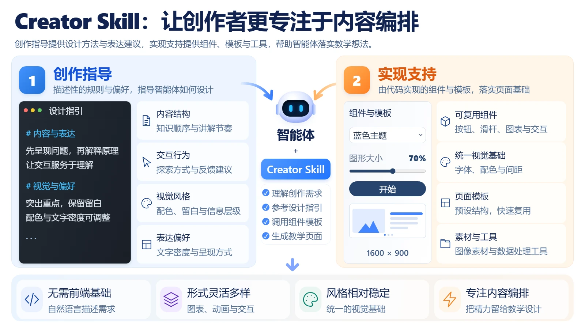
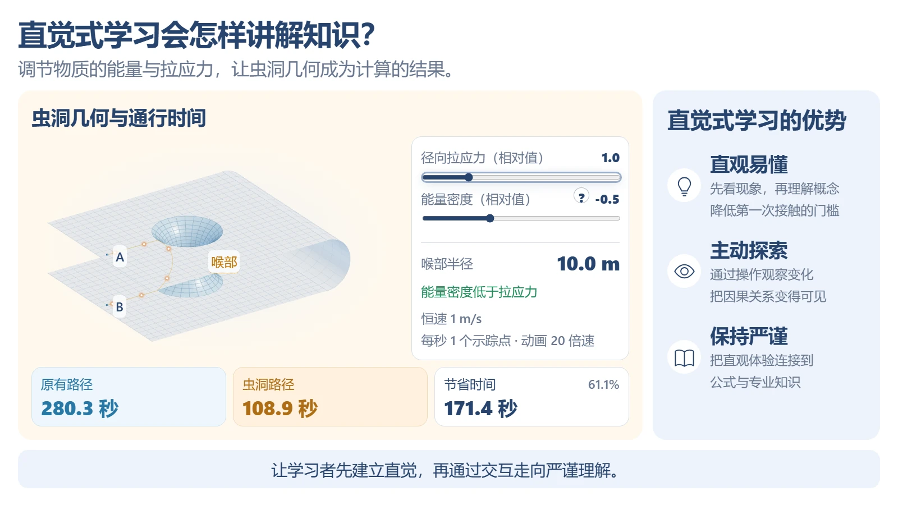
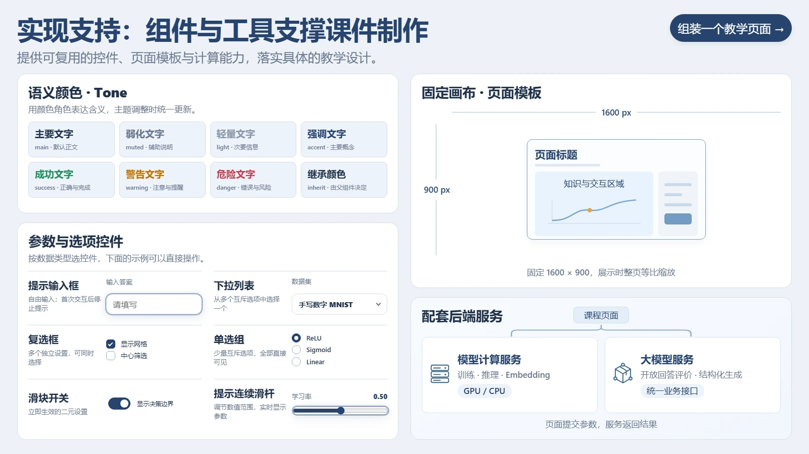
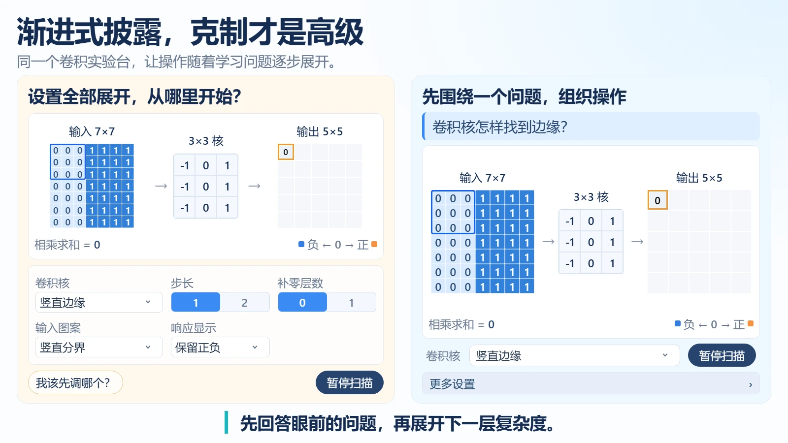
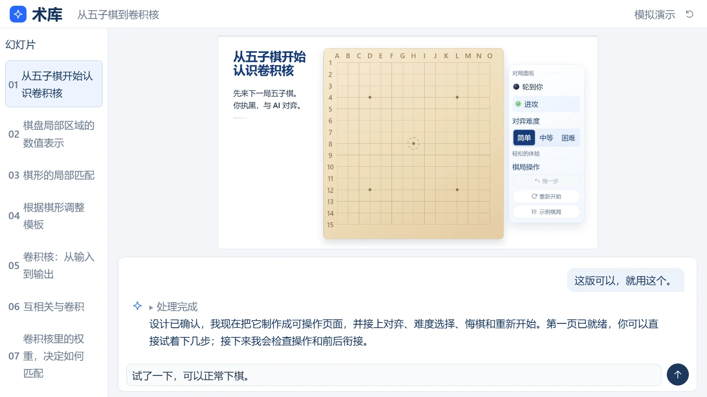

<div align="center">

# Creator Skill

### 把专业知识，变成可以观看、操作和探索的交互演示。

面向 AI 编程助手的 React 演示创作 Skill。<br />
从主题与原稿出发，完成大纲、讲稿、视觉设计、页面实现与真实效果检查。

**教学课件 · 科研汇报 · 商业演示**

[开始使用](#开始使用) · [创作流程](#创作流程) · [实际效果](#实际效果) · [文档导航](#文档导航)

</div>



<p align="center"><sub>上图及下方展示均截取自实际运行的 Creator Guide 课件。静态截图仅展示一个状态，交互由 React 页面实现。</sub></p>

## 做出能讲清楚、也能动手探索的演示

一段文字、一篇论文、一份已有 PPT，都可以成为创作的起点。Creator Skill 为 AI 编程助手提供持续使用的创作流程、设计依据和工程约定，让内容构思与交互实现衔接起来。

| 创作环节 | 具体支持 |
| :--- | :--- |
| **组织内容** | 明确受众与表达目标，梳理主线，编写逐页题目与口播讲稿 |
| **设计表达** | 参考成对视觉案例，选择图形、布局、动画与交互方式 |
| **实现页面** | 使用 React 和配套公共组件，制作 1600 × 900 固定画布演示 |
| **改编原稿** | 从已有 PPT、PDF 或逐页截图出发，重新组织与实现内容 |
| **检查与迭代** | 截取真实页面，检查布局边界、文字与交互，按反馈继续修改 |

## 实际效果

<table>
  <tr>
    <td width="50%">
      
      <br /><strong>让抽象概念可以操作</strong><br />
      调整参数、观察几何与路径变化，把直观体验连接到专业解释。
    </td>
    <td width="50%">
      
      <br /><strong>用公共组件搭建页面</strong><br />
      在统一的视觉与交互基础上，组合课程需要的内容和操作。
    </td>
  </tr>
  <tr>
    <td width="50%">
      
      <br /><strong>保留人的内容判断</strong><br />
      作者提供专业知识、表达目标和反馈，AI 辅助设计与实现。
    </td>
    <td width="50%">
      
      <br /><strong>按理解顺序展开内容</strong><br />
      根据讲解节奏逐步呈现，给观察、思考和讨论留下空间。
    </td>
  </tr>
</table>

[查看截图来源与完整说明 →](docs/showcase.md)

## 创作流程

**明确目标 → 组织大纲与讲稿 → 设计页面 → 确认设计 → React 实现 → 真实检查与验收**

支持两种起点：

- **从零创作**：根据主题、文字、论文或其他材料组织演示。
- **参考改编**：根据已有 PPT、PDF 或页面截图，分析原稿并重新制作。

已有作品可以从当前阶段继续，局部修改只处理受影响页面及必要依赖。具体确认节点和制作批次由对应流程与用户要求决定。



<p align="center"><sub>Creator Guide 内的流程模拟：展示从教学要求到页面预览的协作方式，不代表本仓库自带在线 Agent 服务。</sub></p>

## 开始使用

### 1. 获取 Skill，指定目标工程

将 Skill 克隆到固定位置，可以与课程工程分开放置：

```bash
git clone https://github.com/ReductTech/creator-skill.git creator-skill
```

仅讨论内容、主线或设计，以及查看工具清单与帮助时，无需配置目标。首次需要访问工程时，由 AI 助手根据你指定的课程工程绝对路径，在 Skill 根目录创建本地配置 `target-root.json`。文件不随仓库提供，并已加入 `.gitignore`。格式只有一个字段：

```json
{
  "targetRoot": "D:/Courses/MyProject"
}
```

上面的路径仅为格式示例，实际创建时使用你指定的已存在目录；Windows 路径推荐使用 `/`。未配置或路径无效时工程工具会报错，不会猜测目标，也不会自动创建目录。配置确定后沿用，工具不再以 Skill 所在目录或 `IDL_REPOSITORY_ROOT` 推算工程位置。

目标工程支持 `modules/<UUID>/` 和根目录 `<UUID>/` 两种布局；统一 npm 依赖、运行时、预览与构建由 Shuku 提供。Skill 可独立安装，也可放在课程工程内；构建上传包须排除 Skill。

本仓库根目录已附带完整 `shared/`。初始化用户工程时，AI 助手可直接复制到目标的 `modules/shared/`（平铺布局用 `shared/`），保留风格 UUID；已有 Shared 则复用。详见[复制内置 Shared](references/engineering/module-assets.md#复制内置-shared)。

预期位置如下：

```text
your-course-project/
├── creator-skill/          # 本仓库
│   ├── SKILL.md
│   ├── target-root.json    # 首次使用时创建，Git 忽略
│   ├── references/
│   ├── assets/
│   ├── shared/             # 可直接复制给目标工程的完整默认风格包
│   └── scripts/
├── modules/
│   ├── shared/             # 配套公共组件与播放器
│   └── <课程UUID>/
└── course-styles.json      # 风格登记（如有）
```

### 2. 让 AI 助手读取 Skill

在能够读取工程文件、编写 React 代码并使用所需工具的 AI 编程助手中，明确指定入口：

```text
请先阅读 creator-skill/SKILL.md，并按其中的流程开展创作。

我要制作一份面向大学低年级学生的交互演示，主题是“为什么需要梯度下降”。
先和我讨论主线、大纲与逐页讲稿，再按确认后的设计实现页面。
```

继续修改已有课件时，可以这样描述：

```text
请先阅读 creator-skill/SKILL.md。

继续修改 modules/Your-Course：把第 3 页改成可以调节学习率的演示。
先检查已有实现与依赖，保留其他页面，完成后检查真实渲染与交互。
```

### 3. 按需使用创作工具

在配套课程工程根目录运行：

下面命令以工程内安装为例；独立安装时，用 `tools.py` 的绝对路径调用。执行入口会自动切换到配置的目标工程；查看清单、工具描述和检查 Skill 文档不要求配置目标。

```bash
# 查看工具清单，不执行创作或上传任务
python creator-skill/scripts/tools.py list

# 查看截图工具的用途与依赖
python creator-skill/scripts/tools.py describe capture.slides

# 查看具体参数
python creator-skill/scripts/tools.py capture.slides --help
```

工具覆盖模块初始化、资源检查、原稿提取、真实页面截图和布局校验等任务。详细参数与执行效果见[创作工具索引](references/tools.md)。

### 4. 本地预览课件

本仓库附带 `player-preview/`，使用 Node.js 24+。首次拉取后在本机安装依赖并构建：

```powershell
cd player-preview
npm ci --cache .npm-cache
npm run build
npm run dev
```

打开 [本地预览](http://127.0.0.1:5174/) 或 [播放器演示](http://127.0.0.1:5174/?demo=1)。课件预览复用根目录的 `target-root.json`，并需要 Shuku 的课程运行时。路径配置、目录与常见问题见 [Player Preview 使用说明](player-preview/README.md)。依赖、缓存和 `dist/` 已由 `.gitignore` 排除，源码与 `package-lock.json` 保留，用户自行构建。

### 使用环境

本仓库提供 **Skill、参考资料、辅助工具、默认 Shared 和本地播放器预览源码**；课程运行时和平台后端仍由 Shuku 提供。本地开发预览与官网上传发布分别执行。

| 功能 | 所需环境 |
| :--- | :--- |
| 阅读与执行创作规范 | 支持工程文件读取与代码编辑的 AI 编程助手 |
| 页面实现与预览 | Node.js 24+、Player Preview、目标课程工程与 Shuku 课程运行时 |
| Python 辅助工具 | Python 3.10+；额外依赖按工具需要安装 |
| 页面截图 | Python Playwright、Chromium 和 Pillow |
| PPTX 原稿导出 | Windows 与桌面版 Microsoft PowerPoint |
| 视觉设计图 | 当前 Skill 流程要求可用的 ImageGen 工具 |
| AI 评阅或 GPU 实验 | 配套服务与配置，按页面功能接入 |

截图依赖可以在宿主工程中按需安装：

```bash
python -m pip install -r creator-skill/scripts/requirements-capture.txt
python -m playwright install chromium
```

## 仓库内容

```text
creator-skill/
├── SKILL.md               # AI 助手的创作入口
├── target-root.json       # 使用时创建的本地配置，不纳入 Git
├── references/
│   ├── workflow/          # 从零创作、参考改编与续作规则
│   ├── design/            # 大纲、口播、视觉设计与习题
│   ├── engineering/       # React 实现、资源与脚本约定
│   ├── eval/              # 基础检查与按需评分
│   ├── computing/         # AI 评阅与计算接入说明
│   └── tools.md           # 工具发现与调用说明
├── assets/visual_samples/ # 成对视觉正反例
├── scripts/               # 工具、模板与回归测试
├── shared/                # 完整默认风格包
├── player-preview/        # 播放器与预览源码，使用者自行安装构建
└── docs/                  # 对外展示与实际课件截图
```

## 文档导航

| 我想做什么 | 从这里开始 |
| :--- | :--- |
| 让 AI 助手开始创作 | [Skill 入口](SKILL.md) |
| 从一个主题开始制作 | [从零创作流程](references/workflow/from-scratch.md) |
| 改编已有 PPT 或 PDF | [参考改编流程](references/workflow/reference-adaptation.md) |
| 梳理主线、大纲与逐页讲稿 | [大纲设计](references/design/course-outline.md) · [口播写作](references/design/spoken-narration.md) |
| 设计页面与交互 | [页面设计指导](references/design/design.md) · [视觉案例](assets/visual_samples/) |
| 编写 React 页面、管理素材 | [工程实现](references/engineering/implementation.md) · [资源约定](references/engineering/module-assets.md) |
| 检查实际页面 | [基础检查与验收](references/eval/checks.md) |
| 本地预览课件、构建播放器 | [Player Preview](player-preview/README.md) |
| 查找工具与参数 | [创作工具索引](references/tools.md) |

---

<p align="center"><strong>从知识出发，让表达可以被体验。</strong></p>

## 与术库的关系

本仓库维护创作规范、辅助工具与测试。Shuku 使用自带 `tooling/authoring` 校验器与 `tooling/course-build` 构建器，不从外部 Skill 加载检查器。Skill 的静态预检不能代替当前平台验收；`course.pack --shuku-root <路径>` 使用该 Shuku 的真实导入校验与构建，全部成功才交付源码 ZIP。详见[构建与 ZIP 交付](references/engineering/delivery.md)。

逐页确认与每页 ImageGen 设计图是必需流程，见 [流程共用说明](references/workflow/common.md) 和 [页面设计指导](references/design/design.md)。
