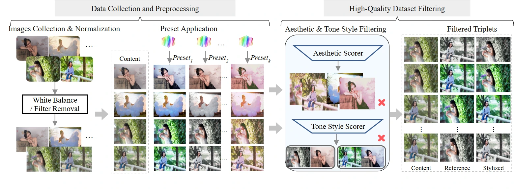
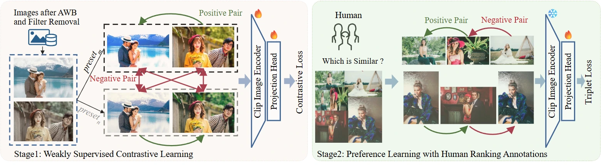

<div align="center">

# Creator Paper Figure

**你来构思，Agent来画：让你专注论文表达，把繁琐绘制操作交给 Agent。**

根据论文内容或参考图绘制配图，支持网页预览、持续编辑与高清 PDF 导出。

[上手示例](#开始使用) · [制作规范](SKILL.md) · [打开本地预览](http://127.0.0.1:5176/)

</div>

## 从单张图到整篇论文配图

既可以复刻、修改一张已有图，也可以根据论文的叙事顺序组织一整套图。先明确每张图要回答的问题，再确定图型与信息密度。

| 配图类型 | 主要表达 | 常见布局 |
| --- | --- | --- |
| Teaser / 整体效果图 | 任务是什么，方法能带来什么结果 | 代表性案例、输入输出、关键局部与简短标识 |
| 方法总览图 | 输入如何经过方法得到输出，贡献在哪里 | 主流程与分支、基础模块、创新模块、对应子图 |
| 机制与模块图 | 一个关键设计具体如何工作 | 局部放大、坐标映射、token、注意力或条件注入 |
| 数据与训练流程图 | 数据如何构建，模型如何训练 | 数据筛选、预处理、样本对、两阶段训练、损失连接 |
| 定性对比图 | 与其他方法相比有哪些可观察的差异 | 方法列、案例行、统一裁剪与局部放大区域 |
| 消融与分析图 | 某个设计或参数如何影响结果 | 使用真实数据绘制的曲线、柱状图、热图及对应案例 |
| 补充材料图 | 更多场景、细节或失败案例 | 延续正文风格的多页案例和对比图组 |

整套配图统一字体、字号层级、模块颜色、箭头样式、方法名和缩写。每张图围绕一个明确目的组织内容，同一模块在不同图中保持一致的视觉标识。

## 创作结果示例

以下示例复刻自论文 **[Towards In-Context Tone Style Transfer with A Large-Scale Triplet Dataset](https://arxiv.org/abs/2604.16114)**（ICTone）的图2和图3，分别展示数据集构建流程和两阶段评分器训练流程。

### 数据集构建流程

数据预处理、候选生成与质量筛选。

[](docs/images/paper-examples/dataset-pipeline.webp)

### 两阶段训练流程

对比学习与偏好学习。

[](docs/images/paper-examples/scorer-training.webp)

## 工作方式

**理解论文与图意 → 规划图组 → 整理素材 → HTML / SVG 绘制 → 网页检查与修改 → PDF 导出**

### 1. 提供内容或参考

可以从以下材料开始：

- 论文草稿、Method 技术上下文、写作大纲或模块说明。
- 一张想复刻布局与风格的论文图。
- PDF 中指定的 Figure 1、Figure 2、Figure 3。
- 输入、输出、baseline、局部裁剪、glyph、mask 等本地素材。
- 已有网页图，需要调整标签、颜色、连线、坐标、字号或排版。

从 PDF 复刻时，先定位原图并拆出照片素材，再绘制标题、流程框、箭头、图例、边界框与整体排版。

### 2. 规划与绘制

整体配图先整理每张图的表达目的、子图关系和所需素材，再逐张落地。有明确参考版式时直接复刻，局部修改在现有实现上继续。

- 以论文贡献为重点，基础骨干与编码器使用克制、统一的视觉样式。
- 区分数据、模块和结果；识别文本、bbox 等结构化输出用可编辑文字表示。
- 对比图保持方法标签、图片宽高、行列间距和局部裁剪的一致性。
- bbox 与放大图准确对应，引线简洁、清晰。
- 根据论文正文布局安排长宽比，保持图片比例。

### 3. 预览与持续修改

每张图对应一页网页 PPT，可以前后翻页，也可以在 Guide 中纵向查看整套图。文字、照片、模块、箭头和颜色均可分别调整。

在网页中检查素材加载、文字大小、连线、边界框位置和整体留白。

### 4. 导出论文文件

从当前网页导出单张 PDF，按论文图的实际比例裁切，保留文字、框和箭头的矢量形式，并嵌入清晰照片。若有约 3 MB 等体积要求，在导出阶段调整照片编码质量，核对细节与文件大小。

源码与素材用于继续编辑，PDF 用于论文排版，也可导出 PNG 或打包源码 ZIP。

## 开始使用

让 AI 助手先阅读 [SKILL.md](SKILL.md)，然后给出目标图、素材和希望保留或修改的内容。

**规划整篇论文配图：**

```text
请先阅读 SKILL.md。

根据我的论文草稿和 Method 技术说明，整理整篇论文需要的配图：
包括 teaser、方法总览、关键模块、数据流程和定性对比。
说明每张图要表达什么、有哪些子图、需要哪些素材，
再将确认后的图绘制成可修改的 HTML / SVG 网页页面。
```

**复刻 PDF 中的图：**

```text
请先阅读 SKILL.md。

将 ICTone_CR.pdf 的图1、图2、图3重绘为3页网页 PPT，
保留原图的布局、配色和照片素材，
文字、模块框、箭头与图例需要能够单独编辑。
保存到 modules/ 下的新图组中。
```

**修改已有图并导出：**

```text
修改现有图组第2页：统一模块蓝色，放大方法名，
让局部图的引线连接到对应 bbox，保留其他页面。
检查网页后导出新的 method.pdf，文件约3 MB。
```

## 环境安装与网页预览

本文所有命令均从 `creator-paper/` 根目录执行，文件路径均相对此目录。

### 1. 安装 Node.js

从 [Node.js 官方下载页](https://nodejs.org/en/download) 下载并安装 **Node.js 24 或更高版本**，安装包包含 npm。Windows 和 macOS 均使用各自系统的安装包。

安装后重新打开终端，确认命令可用：

```sh
node --version
npm --version
```

### 2. 安装项目依赖

首次使用、尚未安装依赖时执行：

```sh
npm --prefix player-preview ci
```

已有依赖时直接启动。

### 3. 启动网页预览

```sh
npm --prefix player-preview run dev -- --host 127.0.0.1 --port 5176 --strictPort
```

打开 **http://127.0.0.1:5176/**，保持终端运行；按 `Ctrl+C` 停止。

上述命令适用于 Windows、macOS 和 Linux。若 PowerShell 限制运行 `npm.ps1`，可使用 `npm.cmd` 执行相同命令。

预览配置保存在 `player-preview/.env.local`。

## 已有图组：ICTone Figures 1–3

图组目录：[modules/c4b8b8d8-17cc-4c49-b518-66b9524d5f76](modules/c4b8b8d8-17cc-4c49-b518-66b9524d5f76)。

| 页面 | 内容 |
| --- | --- |
| 图1 | 8组色调迁移案例，24张独立照片 |
| 图2 | 数据收集、归一化、预设应用及数据筛选 |
| 图3 | 对比学习和偏好学习的两阶段训练 |

素材映射和编辑入口见[该图组说明](modules/c4b8b8d8-17cc-4c49-b518-66b9524d5f76/README.md)。

## 文件与编辑入口

```text
creator-paper/
├── SKILL.md                   # 面向 AI 助手的论文图制作规范
├── README.md                  # 项目说明、用法与本地预览
├── modules/
│   ├── <图组UUID>/
│   │   ├── outlines.json      # 图组及页面信息
│   │   ├── <名称>Ppt.tsx      # 网页 PPT 入口
│   │   ├── <名称>Guide.tsx    # 多页导览入口
│   │   ├── pages/            # 各图独立的可编辑组件
│   │   ├── assets/           # 照片、原始素材和来源记录
│   │   └── figures.css       # 图组共用样式
│   └── shared/               # 只读公共样式与播放器适配
├── player-preview/           # 本地网页预览服务
├── scripts/                  # 素材、检查与导出等辅助工具
├── references/               # 底层接口与工程参考
└── docs/                     # 原图参照、网页效果和必要记录
```

通常在 `pages/` 修改当前图，在样式文件中调整字体和配色，在 `assets/` 管理独立图片。修改已有图时保持图组和页面 UUID 不变；新增图再生成新的页面 UUID。

预览链接使用 `course=<图组UUID>` 和 `page=<页面UUID>` 分别定位图组和页面。

## 检查与交付

检查素材引用、页面顺序、文字与图像完整性、字号、对齐、连线和画布边界，并进行类型检查与本地打包检查。

PDF 导出后检查页数、裁切、字体、图片细节和文件大小，按需交付 PDF、PNG 与源码包。

**后续修改从可编辑网页源码继续，最终论文使用从最新网页导出的配图文件。**
