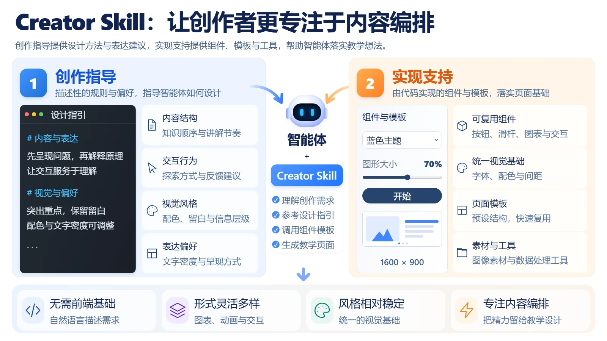
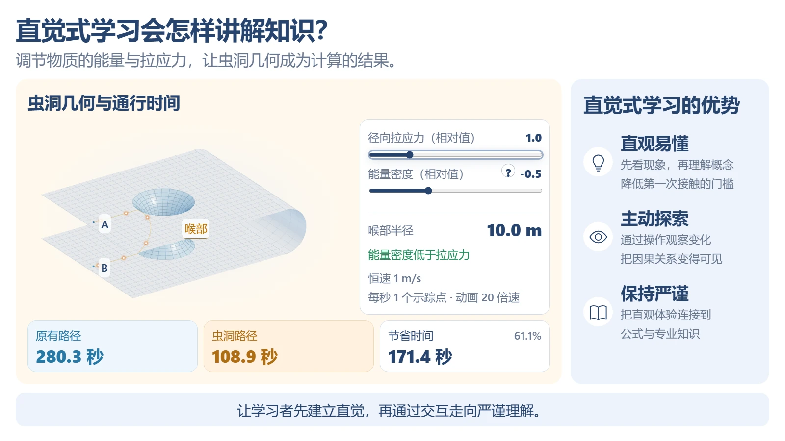
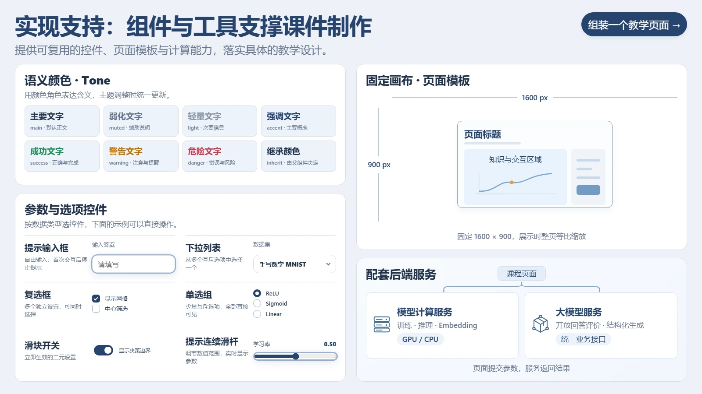
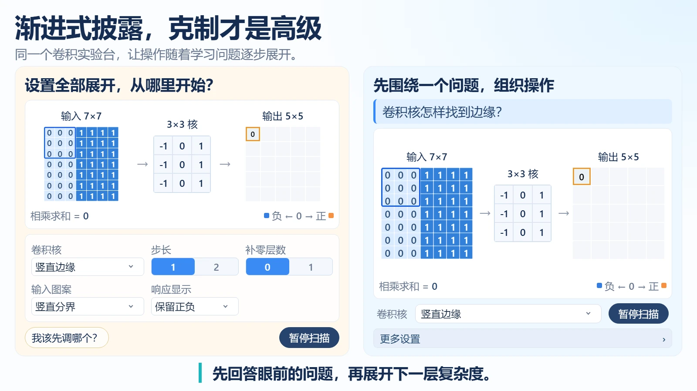

<div align="center">

# Creator Skill

### 把专业知识，变成可以观看、操作和探索的交互演示。

面向 AI 编程助手的 React 演示创作 Skill。<br />
从主题与原稿出发，完成大纲、讲稿、视觉设计、页面实现与真实效果检查。

**教学课件 · 科研汇报 · 商业演示**

[开始使用](#开始使用) · [创作流程](#创作流程) · [实际效果](#实际效果) · [文档导航](#文档导航)

</div>



<p align="center"><sub>上图及下方展示均截取自实际运行的 Creator Guide 课件。静态截图仅展示一个状态，交互由 React 页面实现。</sub></p>

## 做出能讲清楚、也能动手探索的演示

一段文字、一篇论文、一份已有 PPT，都可以成为创作的起点。Creator Skill 为 AI 编程助手提供持续使用的创作流程、设计依据和工程约定，让内容构思与交互实现衔接起来。

| 创作环节 | 具体支持 |
| :--- | :--- |
| **组织内容** | 明确受众与表达目标，梳理主线，编写逐页题目与口播讲稿 |
| **设计表达** | 参考成对视觉案例，选择图形、布局、动画与交互方式 |
| **实现页面** | 使用 React 和配套公共组件，制作 1600 × 900 固定画布演示 |
| **改编原稿** | 从已有 PPT、PDF 或逐页截图出发，重新组织与实现内容 |
| **检查与迭代** | 截取真实页面，检查布局边界、文字与交互，按反馈继续修改 |

## 实际效果

<table>
  <tr>
    <td width="50%">
      
      <br /><strong>让抽象概念可以操作</strong><br />
      调整参数、观察几何与路径变化，把直观体验连接到专业解释。
    </td>
    <td width="50%">
      
      <br /><strong>用公共组件搭建页面</strong><br />
      在统一的视觉与交互基础上，组合课程需要的内容和操作。
    </td>
  </tr>
  <tr>
    <td width="50%">
      
      <br /><strong>保留人的内容判断</strong><br />
      作者提供专业知识、表达目标和反馈，AI 辅助设计与实现。
    </td>
    <td width="50%">
      
      <br /><strong>按理解顺序展开内容</strong><br />
      根据讲解节奏逐步呈现，给观察、思考和讨论留下空间。
    </td>
  </tr>
</table>

[查看截图来源与完整说明 →](docs/showcase.md)

## 创作流程

**明确目标 → 组织大纲与讲稿 → 设计页面 → 确认设计 → React 实现 → 真实检查与验收**

支持两种起点：

- **从零创作**：根据主题、文字、论文或其他材料组织演示。
- **参考改编**：根据已有 PPT、PDF 或页面截图，分析原稿并重新制作。

已有作品可以从当前阶段继续，局部修改只处理受影响页面及必要依赖。具体确认节点和制作批次由对应流程与用户要求决定。


<p align="center"><sub>Creator Guide 内的流程模拟：展示从教学要求到页面预览的协作方式，不代表本仓库自带在线 Agent 服务。</sub></p>

## npm 安装包

本地测试包可直接安装。需要 Node.js 24+（含 npm）。

```powershell
npm install -g ./creator-skill-0.1.0.tgz
creator demo
creator init ./my-course
creator preview ./my-course
```

示例与工程预览会启动本地服务并打开浏览器。终端保持运行，按 Ctrl+C 停止。可加上 `--no-open` 或 `--port 5180`。首次 npm 安装会下载运行依赖。发布课件 ZIP、原稿提取和深入检查仍按实际功能需要 Python、浏览器或媒体工具。AI 助手可读取安装目录里的 `SKILL.md` 与配套资料。

## 开始使用

下载并解压仓库，或用 Git 克隆。安装 Node.js 24+ 后，在仓库根目录运行：

```bash
npm run setup
npm start -- --demo
```

打开终端显示的地址，选择「播放课件」，就能在浏览器中操作入门课件。首次安装需要访问 npm。基本课件的创作与本地预览可以独立使用。Python 3.10+ 用于智能体调用检查和打包工具。

把下面这段复制给有本地文件和终端权限的 AI 助手：

> 请读取 Creator Skill 仓库根目录的 `SKILL.md`。帮我在一个新目录里创建可编辑的课件工程，并在本地打开预览。先告诉我示例是否跑通，再等我提供主题、PPT 或 PDF。

也可以在仓库根目录自行创建和启动工程：

```bash
npm run new -- ../my-course
npm start -- --project ../my-course
```

工程里的 `modules/<课程UUID>/pages/` 存放可编辑的 React 页面。试着修改 `ScalePage.tsx` 中的滑杆参数，保存后浏览器会自动刷新。

### 1. 获取 Skill，指定目标工程

将 Skill 克隆到固定位置，可以与课程工程分开放置：

```bash
git clone https://github.com/ReductTech/creator-skill.git creator-skill
```

仅讨论内容或查看帮助无需绑定工程。需要工程操作时，每个窗口使用 `context.create` 创建独立绑定，不共同改写一个“当前工程”：

```powershell
python <Skill>/scripts/tools.py context.create --target-root <工程绝对路径> --context-directory <当前窗口工作目录> [--module <课程UUID>]
python <Skill>/scripts/tools.py --context <返回的target-root.json绝对路径> course.pack <课程目录>
```

旧的Skill根目录target-root.json仍兼容单窗口默认；新窗口不改它。绑定支持modules/<UUID>/与平铺<UUID>/布局。依赖安装意愿保存在本机账号的独立配置，只问一次，跨窗口共用；详见[本地环境与窗口](references/engineering/local-environment.md)。

本仓库根目录已附带完整 `shared/`。初始化用户工程时，AI 助手可直接复制到目标的 `modules/shared/`（平铺布局用 `shared/`），保留风格 UUID；已有 Shared 则复用。详见[复制内置 Shared](references/engineering/module-assets.md#复制内置-shared)。

预期位置如下：

```text
your-course-project/
├── creator-skill/          # 本仓库
│   ├── SKILL.md
│   ├── target-root.json    # 首次使用时创建，Git 忽略
│   ├── references/
│   ├── assets/
│   ├── shared/             # 可直接复制给目标工程的完整默认风格包
│   └── scripts/
├── modules/
│   ├── shared/             # 配套公共组件与播放器
│   └── <课程UUID>/
└── course-styles.json      # 风格登记（如有）
```

### 2. 让 AI 助手读取 Skill

在能够读取工程文件、编写 React 代码并使用所需工具的 AI 编程助手中，明确指定入口：

```text
请先阅读 creator-skill/SKILL.md，并按其中的流程开展创作。

我要制作一份面向大学低年级学生的交互演示，主题是“为什么需要梯度下降”。
先和我讨论主线、大纲与逐页讲稿，再按确认后的设计实现页面。
```

继续修改已有课件时，可以这样描述：

```text
请先阅读 creator-skill/SKILL.md。

继续修改 modules/Your-Course：把第 3 页改成可以调节学习率的演示。
先检查已有实现与依赖，保留其他页面，完成后检查真实渲染与交互。
```

### 3. 按需使用创作工具

在配套课程工程根目录运行：

下面命令以工程内安装为例；独立安装时，用 `tools.py` 的绝对路径调用。执行入口会自动切换到配置的目标工程；查看清单、工具描述和检查 Skill 文档不要求配置目标。

```bash
# 查看工具清单，不执行创作或上传任务
python creator-skill/scripts/tools.py list

# 查看截图工具的用途与依赖
python creator-skill/scripts/tools.py describe capture.slides

# 查看具体参数
python creator-skill/scripts/tools.py capture.slides --help
```

工具覆盖模块初始化、资源检查、原稿提取、真实页面截图和布局校验等任务。详细参数与执行效果见[创作工具索引](references/tools.md)。

### 4. 预览已有工程

普通作者按环境启用本地检测：已有Node和相关依赖时默认执行静态、类型、本地构建及浏览器检查；缺依赖只问一次并保存安装意愿。Shuku仍独立复核入库、安全和正式发布。媒体处理依赖见[交付说明](references/engineering/delivery.md)。

智能体可使用当前窗口的配置启动预览，从课程列表打开对应课件：

```powershell
npm start -- --context "<context.create 返回的绝对配置路径>"
```

服务地址以终端输出为准。术库宿主服务与正式构建的配置见 [术库本地预览](player-preview/README.md)和[源码 ZIP 交付](references/engineering/delivery.md)。

### 使用环境

本仓库提供 Skill、参考资料、辅助工具、默认 Shared、入门课件和独立本地预览。平台专属能力由术库提供。

| 功能 | 所需环境 |
| :--- | :--- |
| 阅读与执行创作规范 | 支持工程文件读取与代码编辑的 AI 编程助手 |
| 页面实现与预览 | Node.js 24+ 和仓库内置的术库播放器 |
| Python 辅助工具 | Python 3.10+；额外依赖按工具需要安装 |
| 页面截图 | Python Playwright、Chromium 和 Pillow |
| PPTX 原稿导出 | Windows 与桌面版 Microsoft PowerPoint |
| 视觉设计图 | 优先使用助手可调用的生图工具，详见[页面设计指导](references/design/design.md#视觉设计图的工具约束) |
| AI 评阅或 GPU 实验 | 配套服务与配置，按页面功能接入 |

截图依赖可以在宿主工程中按需安装：

```bash
python -m pip install -r creator-skill/scripts/requirements-capture.txt
python -m playwright install chromium
```

## 仓库内容

```text
creator-skill/
├── SKILL.md               # AI 助手的创作入口
├── target-root.json       # 使用时创建的本地配置，不纳入 Git
├── references/
│   ├── workflow/          # 从零创作、参考改编与续作规则
│   ├── design/            # 大纲、口播、视觉设计与习题
│   ├── engineering/       # React 实现、资源与脚本约定
│   ├── eval/              # 基础检查与按需评分
│   ├── computing/         # AI 评阅与计算接入说明
│   └── tools.md           # 工具发现与调用说明
├── assets/visual_samples/ # 成对视觉正反例
├── scripts/               # 工具、模板与回归测试
├── shared/                # 完整默认风格包
├── player-preview/        # Shuku 播放器、课程运行时及本地预览入口
├── starter/               # 入门课件，也是新建工程的模板
└── docs/                  # 对外展示与实际课件截图
```

## 文档导航

| 我想做什么 | 从这里开始 |
| :--- | :--- |
| 让 AI 助手开始创作 | [Skill 入口](SKILL.md) |
| 从一个主题开始制作 | [从零创作流程](references/workflow/from-scratch.md) |
| 改编已有 PPT 或 PDF | [参考改编流程](references/workflow/reference-adaptation.md) |
| 梳理主线、大纲与逐页讲稿 | [大纲设计](references/design/course-outline.md) · [口播写作](references/design/spoken-narration.md) |
| 设计页面与交互 | [页面设计指导](references/design/design.md) · [视觉案例](assets/visual_samples/) |
| 编写 React 页面、管理素材 | [工程实现](references/engineering/implementation.md) · [资源约定](references/engineering/module-assets.md) |
| 检查实际页面 | [基础检查与验收](references/eval/checks.md) |
| 本地预览课件、构建播放器 | [术库本地预览](player-preview/README.md) |
| 查找工具与参数 | [创作工具索引](references/tools.md) |
| 打包与交付 | [源码 ZIP 交付](references/engineering/delivery.md) |
