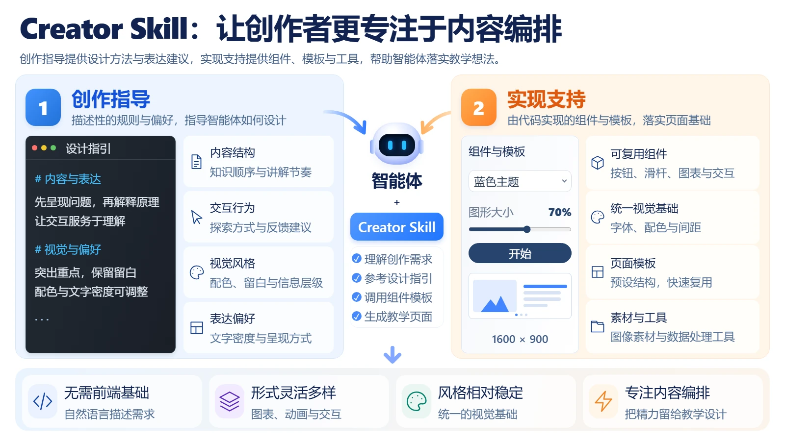
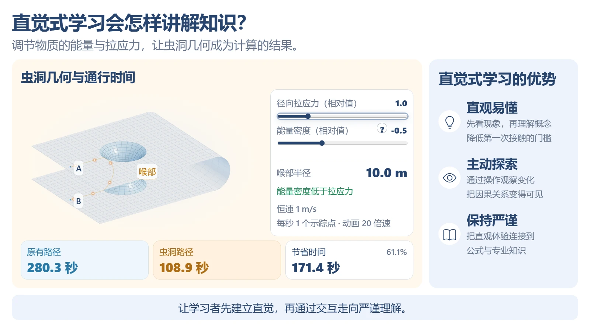
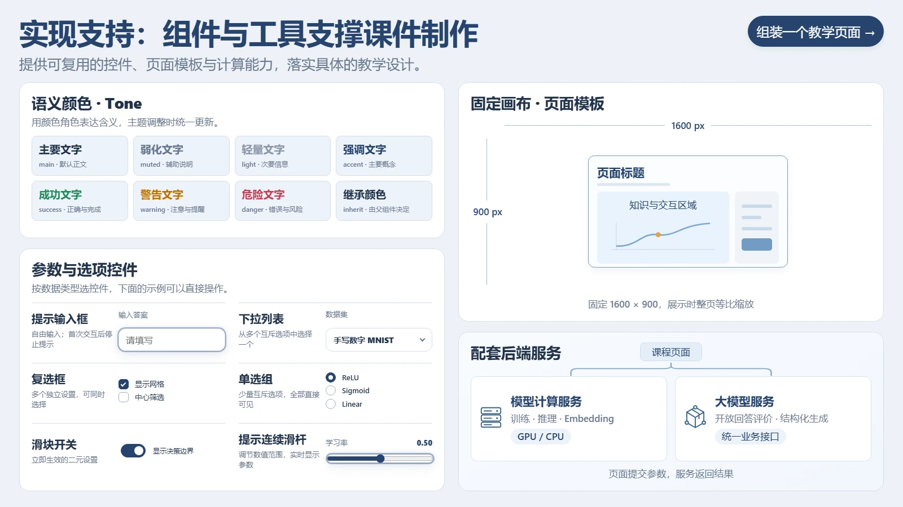
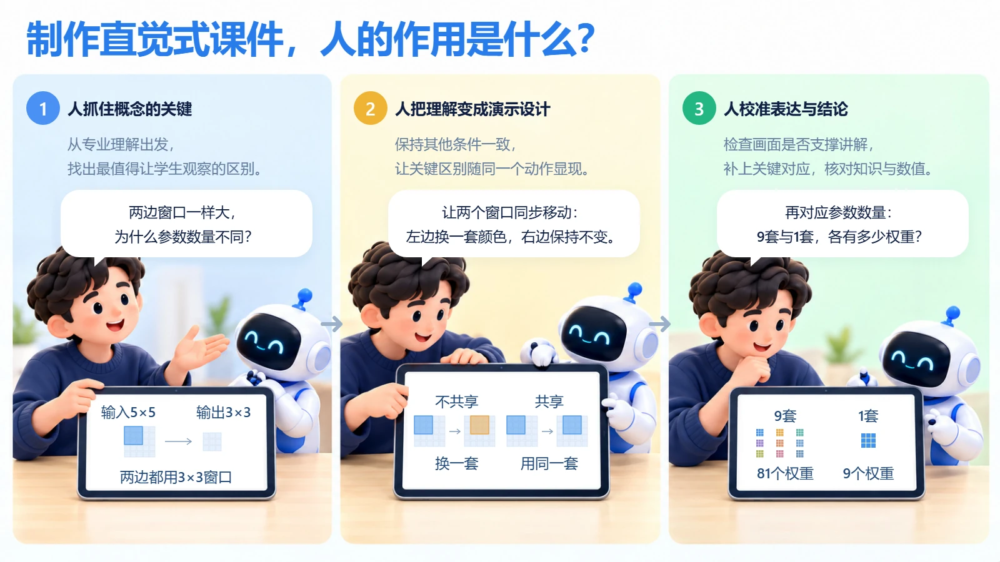
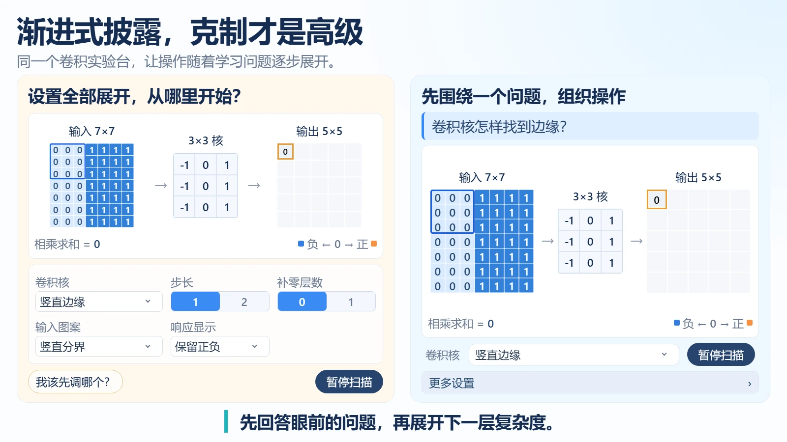
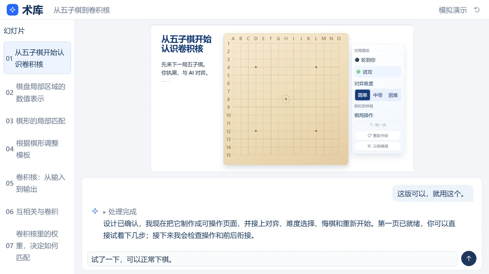

# 实际课件展示

这些截图来自实际运行的 **Creator Guide：直觉式学习课件——理念、工具与创作方法**。页面使用 React 实现，截图通过现有 `capture.slides` 工具从浏览器中获取，未使用设计稿代替运行结果。

README 使用压缩后的 WebP 截图，以减少仓库首页的加载体积。图片保持 1600 × 900 原始画布比例。静态图片不能展示完整交互过程。

## Creator Skill 概览

页面 ID：`skill-overview`。展示创作规范与配套工程能力如何一起支持页面制作；公共组件与播放器属于配套工程，不包含在此 Skill 仓库中。

## 直觉式学习

页面 ID：`intuitive-learning`。利用三维几何和参数调节连接直观体验与专业解释。截图仅代表该演示的一个状态。

## 公共组件

页面 ID：`ui-kit`。展示配套工程中的组件与页面搭建方式。

## 人与 AI 协作

页面 ID：`human-collaboration`。展示内容创作者与 AI 编程助手的分工。

## 渐进呈现

页面 ID：`progressive-disclosure`。展示按理解节奏组织页面信息的方式。

## 创作流程

页面 ID：`creation-workflow`，截图状态：`readme-demo`。通过页面自带的五轮预设对话，展示从教学要求到交互预览的过程。这是课件中的流程模拟，不是真实在线 Agent 服务的执行记录。

## 来源记录

- 源工程：`ReductTech/intuitive-deep-learning-legacy`。
- 课程目录：`modules/Creator-Guide/`。
- 源码基线：`e6fe4498`。
- 截图日期：2026-11-06。
- 截图方式：本地实际浏览器渲染，画布尺寸 1600 × 900。

[返回 README](../README.md)
